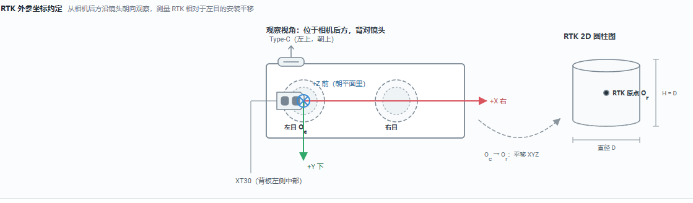

# 安装与接线

## 上电前安全检查

> **危险：** 所有接线必须在 Lite、D20 和飞控断电时完成。先按连接器视角核对 Pin 定义，再核对电压和线序，不得仅按线色判断。

- D20 供电为 5 V，UART/PPS 信号为 3.3 V，禁止将 5 V 接入 TX、RX 或 PPS。
- Lite、D20 和飞控之间必须可靠共地。
- UART 的 TX 与 RX 必须交叉连接。
- 飞控连接 Lite 时只连接 GND、TX、RX，禁止向 Lite 串口接入外部 5 V。

## 推荐连接关系

### D20 到 Lite

| D20 | VIObot2 Lite | 说明 |
| --- | --- | --- |
| TX（3.3 V） | `ttyS3 RX` | 必须连接 |
| RX（3.3 V） | `ttyS3 TX` | 必须连接 |
| PPS | `PPS` | 秒脉冲信号 |
| GND | `GND` | 必须共地 |
| 5 V | `5V` | 按 D20 供电要求连接 |

推荐串口设置为 115200 bps、8N1、无流控。在 Web 的“RTK 波特率”（`rtk_baudrate`）中填写与 D20 相同的值。

### Lite 到飞控

| VIObot2 Lite | 飞控 MAVLink UART | 说明 |
| --- | --- | --- |
| `ttyS4 TX` | RX | 数据发送 |
| `ttyS4 RX` | TX | 双向状态与控制通信 |
| `ttyS4 GND` | GND | 必须共地 |
| 5 V | 不连接 | 禁止反向供电 |

飞控对应 UART 配置为 MAVLink2、921600 bps。Web 的“串口波特率”（`connection_baudrate`）必须与飞控一致。

## VIObot2 Lite 安装方向

产品推荐 **Type-C 朝向机头** 安装，并在 Web 的“相机安装方向”（`camera_orientation`）中选择相同方向。安装后确认：

- 左右目无遮挡，镜头清洁。
- 支架牢固，不会因机体振动松动或明显共振。
- 相机方向与机头方向的关系清晰且记录在验收表中。

## RTK D20 安装

- 安装在天空视野开阔的位置，减少机臂、桨叶、碳板和电池遮挡。
- 远离电机、电调、大电流电源线和强电磁干扰源。
- 固定天线和线缆，避免飞行中松动。
- 记录 D20 定位参考点相对 Lite 左目相机原点的位置。

## RTK 外参坐标

Web 的“RTK 配置”提供外参示意图。外参以左目相机为参考，坐标方向为：

- `+X`：从相机后方朝镜头方向观察时向右。
- `+Y`：向下。
- `+Z`：沿镜头方向向前。

“外参平移 X/Y/Z”（`rtk_extrinsic_x/y/z`）单位为米，表示从左目原点到 RTK 定位参考点的平移。“外参四元数 W/X/Y/Z”（`rtk_extrinsic_qw/qx/qy/qz`）采用 WXYZ 顺序；常规同向安装保持单位四元数。

默认零平移只表示尚未填写测量值，不代表已经完成外参测量。飞控的天线位置参数通常采用机体前、右、下坐标，不能直接复制 Web 中的数值。

